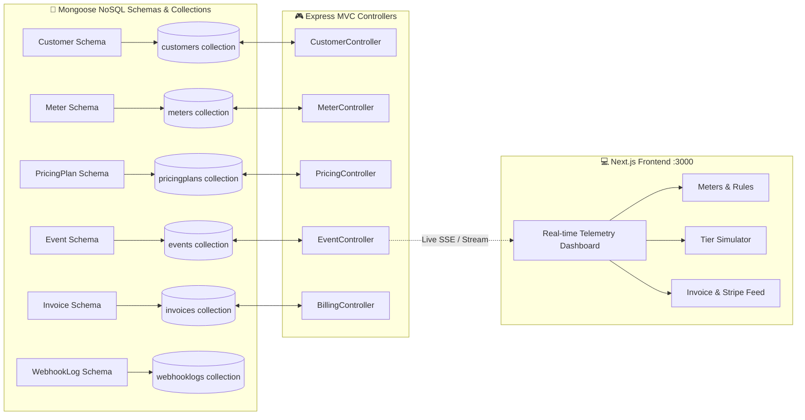

# ⚡ MeterFlow: Usage-Based Pricing & Metering Engine

A production-grade, enterprise-scale **Usage-Based Pricing & Metering Engine** featuring a **High-Throughput API Event Listener** that calculates complex consumption metrics in real-time and feeds directly into billing systems (such as Stripe Billing Engine and Oracle NetSuite ERP).

Built with a **Next.js** frontend and a dedicated **Node.js + Express.js ES Module Backend** using **Mongoose NoSQL Schemas & Models** strictly adhering to the **Model-View-Controller (MVC)** architectural pattern.

---

## 🍃 MongoDB (NoSQL) Mongoose Configuration

The backend connects to MongoDB via **Mongoose** using the connection string configured in `backend/.env`.

### ⚙️ How to Replace Your Database URL:
Open [`backend/.env`](file:///d:/Shubha/backend/.env) and replace the `MONGO_URI` with your MongoDB connection string:

```env
# Option A: MongoDB Atlas Cloud Cluster
MONGO_URI=mongodb+srv://<username>:<password>@cluster0.abcde.mongodb.net/meterflow?retryWrites=true&w=majority

# Option B: Local MongoDB Service / Compass
MONGO_URI=mongodb://127.0.0.1:27017/meterflow
```

The database connection is defined and explained in detail inside [`backend/config/db.js`](file:///d:/Shubha/backend/config/db.js). It includes automatic lifecycle events, timeouts, and zero-downtime resilience so the API always responds even while connecting.

---

## 💻 Frontend Render Backend URL Configuration

The Next.js frontend communicates with your backend via `NEXT_PUBLIC_API_URL` configured in [`frontend/.env.local`](file:///d:/Shubha/frontend/.env.local).

### ⚙️ How to Connect Frontend to your Render Backend:
Open [`frontend/.env.local`](file:///d:/Shubha/frontend/.env.local) and replace the URL with your Render live backend service:

```env
# For Local Development:
# NEXT_PUBLIC_API_URL=http://localhost:5001/api/v1

# For Render Backend Deployment:
NEXT_PUBLIC_API_URL=https://<your-render-backend-service>.onrender.com/api/v1
```

> **Note:** When deploying the frontend to **Vercel** or **Render**, add `NEXT_PUBLIC_API_URL` in your platform's Environment Variables dashboard with value `https://<your-render-backend-service>.onrender.com/api/v1`.

---

## 🏗️ Architecture & Model Schema Export



---

## 📂 Backend File Organization

```
d:/Shubha/backend/
├── package.json                         # Configured with "type": "module"
├── server.js                            # App entry point, Mongoose connection bootstrap
├── .env                                 # MONGO_URI configuration (Replace URL here)
├── .env.example                         # Environment template
├── config/
│   ├── db.js                            # Mongoose connection with lifecycle event listeners
│   └── constants.js                     # Aggregation types, pricing models, defaults
├── models/                              # Mongoose Schemas & Exported Model Tables
│   ├── index.js                         # Centralized barrel export
│   ├── Customer.js                      # customerSchema -> Customer model
│   ├── Meter.js                         # meterSchema -> Meter model
│   ├── PricingPlan.js                   # pricingPlanSchema -> PricingPlan model
│   ├── Event.js                         # eventSchema -> Event model (indexes & idempotency)
│   ├── Invoice.js                       # invoiceSchema -> Invoice model
│   └── WebhookLog.js                    # webhookLogSchema -> WebhookLog model
├── views/                               # MVC Presentation & Serialization Layer
│   ├── eventView.js                     # API response serializers & telemetry
│   ├── meterView.js                     # Aggregated metrics presentation
│   ├── billingView.js                   # Stripe webhook payload & invoices
│   └── invoiceHtmlView.js               # Printable executive HTML invoice template
├── controllers/                         # MVC Controllers (Using Mongoose Models)
│   ├── eventController.js               # Ingestion, batch events, SSE live stream
│   ├── meterController.js               # Meter CRUD & sliding window aggregations
│   ├── pricingController.js             # Plan management & rate card simulation
│   ├── customerController.js            # Tenant usage summary & budget tracking
│   ├── billingController.js             # Invoice generation & billing feed trigger
│   └── simulatorController.js           # Background traffic load generator
├── routes/                              # Express Route Definitions
│   ├── eventRoutes.js
│   ├── meterRoutes.js
│   ├── pricingRoutes.js
│   ├── customerRoutes.js
│   ├── billingRoutes.js
│   └── simulatorRoutes.js
└── services/                            # Core High-Throughput Engines
    ├── meteringEngine.js                # Aggregations (SUM, MAX, COUNT, etc.) & SSE
    ├── pricingEngine.js                 # Graduated, volume, and package pricing math
    ├── billingFeedService.js            # Webhook dispatch with HMAC-SHA256
    └── simulatorService.js              # Synthetic load generator & scenarios
```

---

## 🚀 Running the Project

### 1. Backend (Port 5001)
```powershell
cd d:\Shubha\backend
node server.js
```
- Listening at: `http://localhost:5001`
- Health & DB check: `http://localhost:5001/api/v1/health`

### 2. Frontend (Port 3000)
```powershell
cd d:\Shubha\frontend
npm run dev
```
- Available in browser at: `http://localhost:3000`
